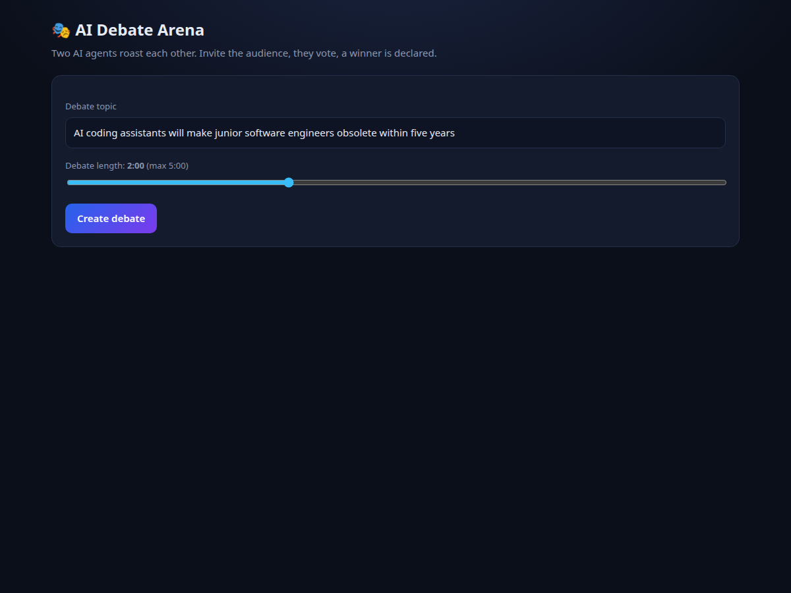
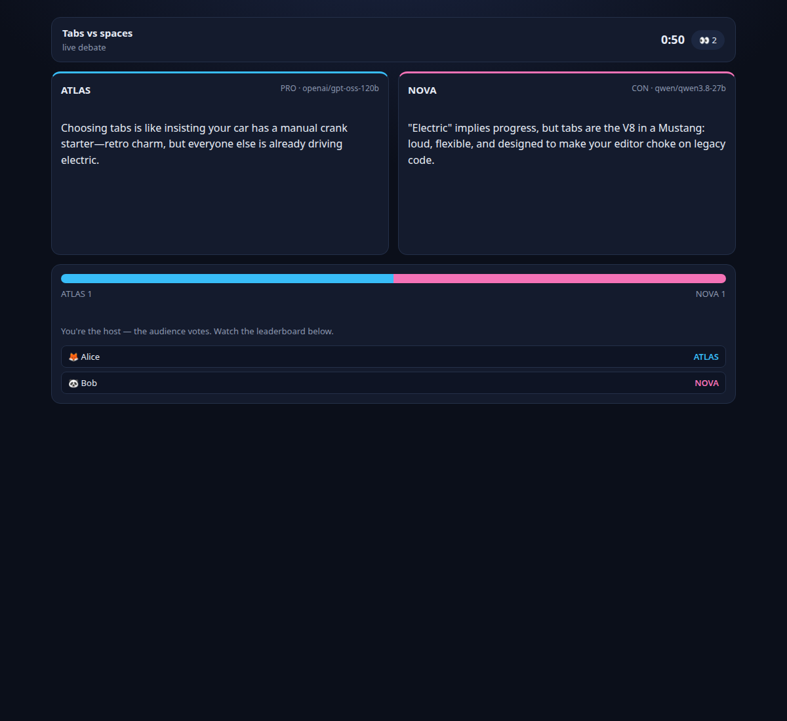
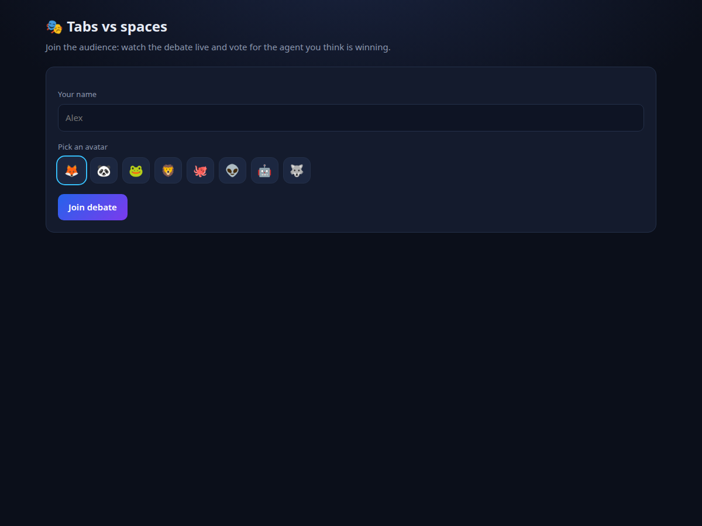

# AI Debate Arena

Two AI agents roast each other live. One person creates a debate, invites the
audience, and the audience votes — the host follows a live "who voted for whom"
leaderboard. The winner is declared from the votes.

- Two LangGraph agents (GPT-OSS vs Qwen), each with its own API key
- 100–150 character replies, streamed token by token
- 4.5 second pause between turns so the audience can read
- Side-by-side arena, live vote bar, vote switching
- Host leaderboard: every participant's name, avatar and their vote
- Join requires a display name + avatar before you can vote
- Debate length configurable up to 5 minutes
- Creator lobby with invite link + joined viewers

**Live Demo:** [Click here](https://neural-debate-1.onrender.com)

## Screens







## Stack

FastAPI + WebSockets, LangGraph/LangChain, Groq, Tavily (DuckDuckGo fallback),
LangSmith tracing, and a single vanilla HTML/CSS/JS page — no build step.

## Run

```bash
cd backend
uv venv && uv pip install -r requirements.txt   # first time only
.venv/bin/python -m uvicorn app.main:app --port 8000
```

Open **http://localhost:8000**.

Required in the repo-root `.env`:

```bash
GROQ_API_KEY_A=gsk_...     # agent A (falls back to GROK_API_KEY1)
GROQ_API_KEY_B=gsk_...     # agent B (falls back to GROK_API_KEY2)
TAVILY_API_KEY=tvly-...    # optional, DuckDuckGo is the fallback
```

## How it works

1. **Create** — pick a topic and a duration (30 s – 5 min). You land on the host page.
2. **Invite** — copy the invite link (`/join/<id>`); viewers enter a name + avatar.
3. **Start** — the host starts the debate; both agents take turns, streaming live.
4. **Vote** — viewers vote for A or B at any time and can switch. The host watches
   the same screen plus a leaderboard of who voted for whom, but cannot vote.
5. **Winner** — when the timer ends, the agent with more votes wins (ties are draws).

## Layout

```
backend/
├── app/debate/graph.py        # the two agent graphs + debate graph
├── app/debate/tools.py        # web_search tool (Tavily → DuckDuckGo)
├── app/web/app.py             # FastAPI: REST, WebSocket, rooms, votes
├── app/main.py                # entrypoint (uvicorn app.main:app)
├── static/index.html          # the whole frontend (create / join / arena)
├── terminal_debate.py         # CLI version of the debate
├── graphs/                    # rendered graph diagrams
└── requirements.txt
```

## Terminal version

Same engine without the UI:

```bash
cd backend
.venv/bin/python terminal_debate.py                 # 60 second debate
.venv/bin/python terminal_debate.py --graph         # print/render both graphs
```

## Configuration

| Variable | Meaning |
|---|---|
| `GROQ_API_KEY_A` / `GROK_API_KEY1` | agent A key |
| `GROQ_API_KEY_B` / `GROK_API_KEY2` | agent B key |
| `GROQ_MODEL_A`, `GROQ_MODEL_B` | model IDs |
| `TAVILY_API_KEY` | search provider (DDG fallback) |
| `WEB_PAUSE_SECONDS` | pause between web turns (default 4.5) |
| `TURN_PAUSE_SECONDS` | pause between terminal turns (default 3.5) |
| `LANGCHAIN_TRACING_V2`, `LANGCHAIN_API_KEY`, `LANGCHAIN_PROJECT` | LangSmith |

## License

MIT — see [LICENSE](LICENSE).
