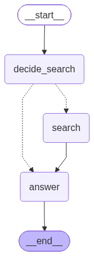
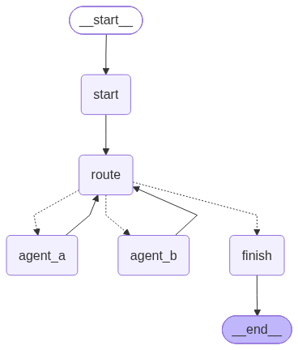

# Debate engine (LangGraph)

Three files:

| File | Contents |
|---|---|
| `app/debate/graph.py` | settings, prompts, both graphs, terminal output |
| `app/debate/tools.py` | `web_search` LangChain tool (Tavily → DuckDuckGo) |
| `terminal_debate.py` | CLI |

## Graphs



Each agent: `START → decide_search → (search →) answer → END`
The router replies `SEARCH: <query>` or `ANSWER`; on failure a keyword heuristic decides.



The orchestrator alternates `agent_a` / `agent_b`, passes the previous speaker's
argument into the next turn, and stops at the time budget or turn cap.

Regenerate the images with:

```bash
.venv/bin/python terminal_debate.py --graph
```

## Agent replies

The system prompt asks for ONE funny sentence of 100–150 characters (a roast with
an analogy). If the opponent explicitly asks for detail ("elaborate", "give me the
numbers", …) the limit becomes 300 characters. `_fit()` trims anything that still
runs long at a word boundary.

## Events (used by the web app)

`run_debate(..., emit=callback, verbose=False, pause=4.5)` emits:

| Event | Payload |
|---|---|
| `turn_start` | agent, name, turn, opening |
| `search` | agent, query |
| `token` | agent, text (streaming chunk) |
| `turn_end` | agent, name, turn, text, citations |
| `cooldown` | seconds_left, next |

## Run

```bash
cd backend
.venv/bin/python terminal_debate.py                  # 60 s
.venv/bin/python terminal_debate.py -t "Motion" -s 90 -n 20
.venv/bin/python terminal_debate.py --graph
```

## Env (repo-root `.env`)

| Variable | Meaning |
|---|---|
| `GROQ_API_KEY_A` or `GROK_API_KEY1` | Agent A key (Key1) |
| `GROQ_API_KEY_B` or `GROK_API_KEY2` | Agent B key (Key2) |
| `GROQ_MODEL_A`, `GROQ_MODEL_B` | models (`openai/gpt-oss-120b`, `qwen/qwen3.8-27b`) |
| `AGENT_A_NAME`, `AGENT_B_NAME` | display names |
| `GROQ_ROUTER_MODEL` | search router (`openai/gpt-oss-20b`) |
| `TAVILY_API_KEY` | primary search provider |
| `DEBATE_SECONDS`, `DEBATE_MAX_TURNS`, `MIN_TURN_SECONDS` | budget defaults |
| `TURN_PAUSE_SECONDS` | reading pause in the terminal (default 3.5) |
| `WEB_PAUSE_SECONDS` | reading pause in the web app (default 4.5) |
| `LANGCHAIN_TRACING_V2`, `LANGCHAIN_API_KEY`, `LANGCHAIN_PROJECT` | LangSmith |
